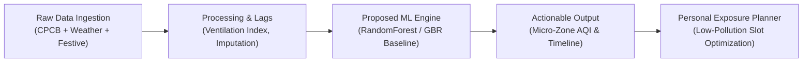
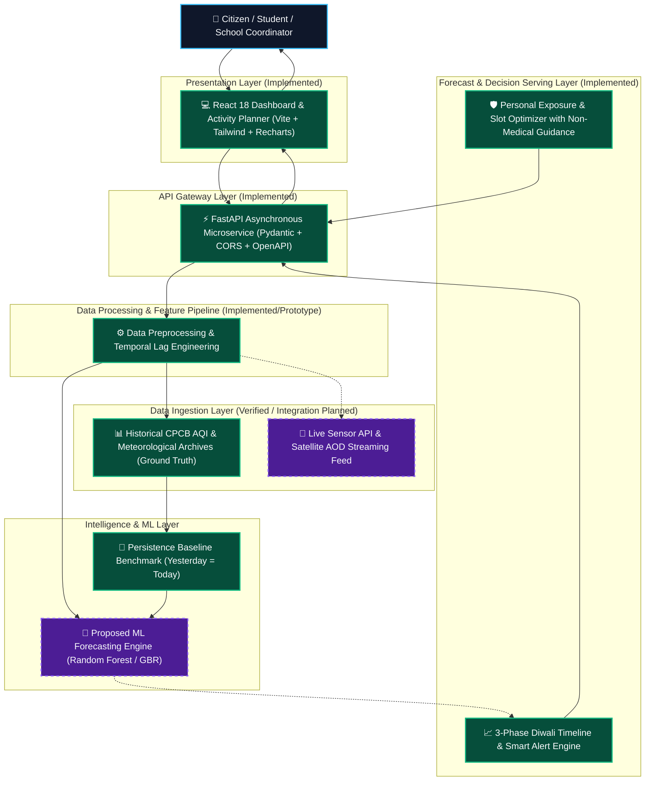

# AirPulse

> **AI-Powered Diwali Air Quality Prediction**  
> *Predict Pollution. Understand Exposure. Make Better Decisions.*

[](https://www.python.org/)
[](https://fastapi.tiangolo.com/)
[](https://react.dev/)
[](https://vitejs.dev/)
[](https://tailwindcss.com/)
[](#)

---

## 1. Original Problem Statement

> **Develop an AI-powered platform to predict neighbourhood-level air pollution before, during, and after Diwali by analysing historical air-quality data, weather conditions, traffic patterns, and other relevant environmental indicators.**

The project aims to empower citizens, students, educational institutions, and outdoor planners to understand expected air-quality conditions in their immediate neighbourhood and make proactive, exposure-reducing choices rather than relying on delayed city-wide metrics.

---

## 2. Problem Explanation: Beyond The City Average

Every year during Diwali, major Indian urban agglomerations experience hazardous pollution spikes. Conventional meteorological dashboards report a single consolidated index (e.g., *"Delhi AQI: 380 — Very Poor"*).

However, **city-wide averages mask critical neighbourhood realities**:
- **Micro-Climatic Disparities:** Simultaneously, green corridors like Lodhi Road or open zones like IGI Airport may record an AQI of 230, while heavy transit choke-points and dense residential pockets like Anand Vihar, Jahangirpuri, or Rohini cross 490+ into the hazardous *Severe+* category.
- **The Diwali Compound Surge:** Three independent phenomena collide:
  1. Intense nocturnal pyrotechnic emissions (bursts of PM2.5, PM10, barium, sulfur).
  2. Winter temperature inversion (boundary layer collapse trapping smoke close to breathing level).
  3. Stagnant surface winds (<2 m/s) preventing atmospheric ventilation for 48–72 hours post-Diwali.
- **The Citizen Decision Void:** Existing systems are retrospective—they report what you inhaled two hours ago. Citizens need predictive foresight to reschedule outdoor activities before toxic exposure occurs.

---

## 3. Proposed Solution

AirPulse creates an environmental intelligence pipeline that:
1. **Analyses Multi-Source Historical Data:** Ingests continuous ambient air quality records (CPCB CAAQMS), weather indicators (temperature, humidity, wind velocity, boundary layer height), and festive traffic patterns.
2. **Forecasts Hyperlocal Micro-Zones:** Projects air quality at the neighbourhood level across supported urban zones.
3. **Presents a 3-Phase Diwali Timeline:** Visualizes distinct temporal phases—Pre-Diwali accumulation, Diwali Night peak surge, and Post-Diwali dispersion.
4. **Delivers Decision Support:** Bridges the gap between abstract numbers and personal behavior through the *Personal Pollution Exposure Planner*.



---

## 4. Core Features

### A. Neighbourhood-Level AQI Forecasting
- Allows users to select specific monitored urban micro-zones (e.g., *Anand Vihar*, *Lodhi Road*, *Rohini*, *Dwarka*, *Punjabi Bagh*, *IGI Airport*).
- Displays measured CPCB ground observations (PM2.5, PM10, AQI) alongside predictive forecast curves.
- **Strict Transparency:** Clearly distinguishes measured ground truth from demonstration predictive models.

### B. 3-Phase Diwali Pollution Timeline
- **Phase 1: Pre-Diwali Build-up (Days -3 to -1):** Baseline agricultural stubble transit, festive shopping traffic, and ambient temperature drop.
- **Phase 2: Diwali Peak Surge (Diwali Day to Day +1 02:00 AM):** Nocturnal firecracker spikes combined with temperature inversion trapping.
- **Phase 3: Post-Diwali Dispersion (Days +2 to +4):** Slow atmospheric evacuation under calm surface wind conditions.

### C. Neighbourhood Comparison & Heatmap
- Side-by-side disparity analysis across all supported micro-zones.
- Risk-tier categorization matching official National Air Quality Index (NAQI) standards:
  - Good (0–50) | Satisfactory (51–100) | Moderate (101–200) | Poor (201–300) | Very Poor (301–400) | Severe+ (401–500)
- Helps citizens identify cleaner corridors (e.g. urban parks) vs heavy diesel/firecracker choke-points.

### D. Environmental Insights & Smart Alerts
- Correlates ambient temperature, relative humidity, and surface wind speed with particulate entrapment.
- **Smart Pollution Alerts:** Automated alerts identifying severe projected threshold breaches (>400 AQI) and daylight thermal dispersion windows.

---

## 5. Differentiating Extra Feature: Personal Pollution Exposure Planner

The **Personal Pollution Exposure & Activity Planner** translates forecast data into actionable scheduling adjustments to minimize inhaled particulate burden.

### How It Works:
1. **Activity Selection:** Select from **Walking**, **Outdoor Sports**, **Commuting**, or **Outdoor Events**.
2. **Date & Slot Comparison:** Evaluates Early Morning (06:00 – 08:30 AM), Midday Thermal Window (01:00 – 03:30 PM), and Night Festive Window (07:30 – 10:30 PM).
3. **Comparative Exposure Reduction:** Highlights the optimal window—for example, shifting an outdoor workout from 6:00 AM (AQI 425) to 1:30 PM (AQI 295) can reduce particulate exposure by over **30%** due to midday solar ventilation.
4. **Practical Risk-Reduction Guidance:** Practical suggestions such as wearing certified N95 masks, activating vehicle cabin air recirculation, and scheduling indoor alternatives.

> ⚠️ **Health Governance & Ethical Disclaimer:**  
> AirPulse is strictly an **environmental awareness and activity-scheduling tool**, **NOT a medical diagnosis system**. It does not diagnose asthma or clinical respiratory ailments, does not prescribe medications or treatment alterations, and does not claim any outdoor activity is completely risk-free. Zero sensitive personal medical data is requested or stored.

---

## 6. System Architecture



---

## 7. Technology Stack

| Layer | Technology | Justification |
| :--- | :--- | :--- |
| **Frontend** | React 18, Vite | Component-based reactivity, rapid hot module reloading, lightweight production bundle. |
| **UI & Styling** | Tailwind CSS, Lucide | Responsive dark environmental theme (`#0B132B` / `#10B981`), accessible contrast. |
| **Data Viz** | Recharts | Hardware-accelerated SVG time-series charts with custom tooltips and responsive containers. |
| **Backend API** | Python 3, FastAPI, Uvicorn | Asynchronous endpoint execution, Pydantic type validation, auto-generated OpenAPI docs. |
| **Data Processing** | Pandas, NumPy | Vectorized time-series manipulation, rolling window statistics, lag feature construction. |
| **Machine Learning** | Scikit-learn | Transparent regression baselines (RandomForest, GradientBoosting) with clear feature importances. |
| **Version Control** | Git, GitHub | Modular repository organization, branch isolation, reproducible setup. |

---

## 8. Project Structure

```
AirPulse/
├── backend/
│   ├── main.py                  # FastAPI server with all REST endpoints & exposure planner logic
│   └── requirements.txt         # Backend Python dependencies
├── frontend/ (or root src/)
│   ├── src/
│   │   ├── components/          # UI cards, timeline charts, heatmaps, exposure planner
│   │   ├── App.jsx              # Main dashboard application container
│   │   ├── main.jsx             # React entry point
│   │   └── index.css            # Tailwind styles & theme variables
│   ├── package.json             # Frontend dependencies & Vite scripts
│   └── vite.config.js           # Vite build configuration
├── ml/
│   ├── README.md                # Comprehensive ML research blueprint & evaluation methodology
│   ├── train.py                 # Runnable benchmark training script (Baseline vs Regressor)
│   └── predict.py               # Multi-phase forecast inference routine
├── data/
│   └── README.md                # CPCB data schema, weather sources, licensing, and limitations
├── docs/
│   ├── architecture.md          # In-depth architectural flow, component breakdown, and Mermaid diagrams
│   └── feature_scope.md         # Detailed product specification, user personas, and health governance
├── presentation/
│   ├── AirPulse_Hackathon_Round1.pptx # Editable 8-slide widescreen PowerPoint presentation
│   ├── generate_presentation.py # Automation script generating the presentation
│   ├── presentation_script.md   # Slide-by-slide speaker notes with timing and Hinglish tips
│   └── judge_questions.md       # Anticipated judge questions with winning technical answers
├── README.md                    # Project documentation (this file)
└── .gitignore                   # Ignored files (node_modules, venv, cache)
```

---

## 9. Setup & Run Instructions

### Prerequisites
- Node.js 18+ and npm
- Python 3.10+ and pip

### Step 1: Clone Repository
```bash
git clone https://github.com/your-username/AirPulse.git
cd AirPulse
```

### Step 2: Backend Setup
```bash
cd backend
pip install -r requirements.txt
python main.py
```
*The FastAPI backend will start at `http://localhost:8000`. Interactive API documentation is accessible at `http://localhost:8000/docs`.*

### Step 3: Frontend Setup
```bash
# In another terminal window:
npm install
npm run dev
```
*The React application will launch at `http://localhost:5173`.*

### Step 4: Run Machine Learning Benchmark
```bash
python ml/train.py
```
*Executes the baseline persistence comparison and outputs MAE and RMSE metrics.*

---

## 10. Data Source Plan & Validation Rigor

| Source | Parameters | Status |
| :--- | :--- | :--- |
| **CPCB CAAQMS Stations** | PM2.5, PM10, NO2, SO2, CO, Ozone | Ground truth schema verified; demonstration values in prototype |
| **IMD / OpenWeather** | Temperature, Humidity, Wind Speed, Inversion | Atmospheric factors integrated in lag pipeline |
| **Mobility & Festive Calendar** | Traffic congestion index, Diwali night marker | Integrated in temporal feature engineering |

### Zero Fabricated Statistics Policy
- AirPulse does **NOT** claim an invented 99% accuracy score.
- Model performance is evaluated strictly using **Mean Absolute Error (MAE)** and **Root Mean Squared Error (RMSE)** on chronological test sets.
- Models must outperform a **Persistence Baseline** ($AQI_{t} = AQI_{t-24}$) to demonstrate genuine predictive utility.

---

## 11. Current Implementation Status

| Feature / Component | Status in Round 1 | Verification |
| :--- | :--- | :--- |
| **Interactive React Dashboard** | ✅ Implemented | Live responsive dark theme with micro-zone selector |
| **3-Phase Diwali Timeline** | ✅ Implemented | Visual temporal chart covering pre, peak, post Diwali |
| **Neighbourhood Comparison & Heatmap** | ✅ Implemented | Side-by-side risk cards & comparative rankings |
| **Smart Pollution Alerts** | ✅ Implemented | Critical threshold breach notices |
| **Personal Exposure Planner** | ✅ Implemented | Slot evaluator with non-medical exposure reduction tips |
| **FastAPI REST Service** | ✅ Implemented | Asynchronous endpoints with Pydantic validation |
| **ML Baseline Pipeline** | ✅ Implemented | `ml/train.py` evaluates persistence baseline vs Regressor |
| **PowerPoint Presentation** | ✅ Implemented | `presentation/AirPulse_Hackathon_Round1.pptx` (8 slides, 16:9) |
| **Live Sensor Streaming Feed** | 🔄 Planned (Round 2) | Real-time CPCB API streaming integration |
| **Advanced Neural Models (TCN/LSTM)** | 🔄 Planned (Round 2) | Multi-year model training on full historical sensor archive |

---

## 12. Limitations & Challenges

1. **Station Spatial Sparsity:** Monitoring stations are spaced several kilometres apart. Intervening areas require spatial interpolation.
2. **Episodic Human Irregularity:** Firecracker emissions depend on localized enforcement and community compliance, creating high variance during peak festive hours.
3. **Sensor Maintenance Dropouts:** Ground stations occasionally experience maintenance dropouts during severe episodes, requiring robust imputation.

---

## 13. Future Scope & Potential Startup Direction

### Short-Term Roadmap (Hackathon Round 2 & 3)
- Validate Gradient Boosting (LightGBM/XGBoost) on multi-year festival archives (2018–2025).
- Ingest satellite Aerosol Optical Depth (AOD) data from Sentinel-5P TROPOMI.
- Expand geographical coverage across high-risk northern Indian industrial belts (Kanpur, Lucknow, Patna).

### Long-Term Environmental Intelligence Startup Vision
- **B2B School & Sports Safety API:** Automated scheduling platform for private schools and sports academies to conduct outdoor activities during low-toxicity windows.
- **Delivery Fleet Worker Protection:** Dynamic shift and route optimization for quick-commerce and delivery fleets (Zomato, Swiggy, Amazon) during high-smog periods.
- **Municipal Smog Gun Deployment Advisory:** Micro-zone predictive guidance for municipal corporations to dispatch misting and anti-smog trucks proactively to projected hotspots.

---

## 14. Conclusion

> **"AirPulse — Predict Pollution. Understand Exposure. Make Better Decisions."**

*Developed for Hackathon 2026 — Round 1 Deliverable.*
