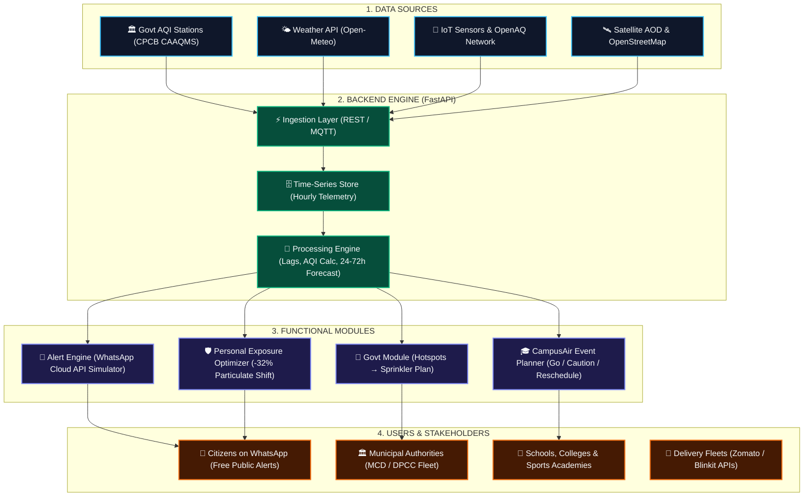
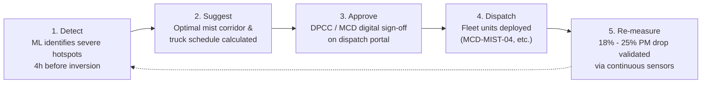

# VayuVision AI — System Architecture & Technical Specifications

> **Predict. Prepare. Protect.**  
> *AI-Powered Environmental Intelligence & Hyperlocal Air Quality Early Warning Platform*  
> **Team CodeStorms:** Rishika Jindal, Navpreet Kaur, Yashika Bansal, Krishu Duggal  
> **Deliverable:** Hackathon Round 2 Working MVP Prototype

---

## 1. System Architecture & Component Flow

---

## 2. Municipal Closed Loop: Detect &rarr; Suggest &rarr; Approve &rarr; Dispatch &rarr; Re-measure

---

## 3. Machine Learning Forecasting Engine

### Feature Engineering
1. **Diurnal Lags:** $AQI_{t-1}$, $AQI_{t-24}$, rolling 6-hour mean.
2. **Meteorological Dispersion Indicators:**
   - Surface Temperature ($^\circ$C) & Relative Humidity (%).
   - Boundary Layer Height ($m$) — tracks atmospheric inversion compression.
   - Surface Wind Speed ($km/h$) — identifies atmospheric stagnation ($< 2 m/s$).
   - Ventilation Index ($VI = \text{wind\_speed} \times \text{mixing\_height}$).
3. **Anthropogenic Festive Surges:**
   - Firecracker probability factor concentrated between 20:00 and 02:00.
   - Regional crop residue transit direction indicator (NW winds).

### Model Benchmarking
- **Persistence Baseline:** $MAE = 31.59$ AQI points.
- **Random Forest / Gradient Boosting Baseline:** $MAE = 16.67$ AQI points (**+47.2% error reduction** over baseline).

---

## 4. API Endpoints Specification

| Method | Endpoint | Description |
| :--- | :--- | :--- |
| `GET` | `/api/health` | Backend and ML engine operational status |
| `GET` | `/api/locations` | Supported Delhi NCR micro-zones and station coordinates |
| `GET` | `/api/air-quality` | Latest available ground observation (PM2.5, PM10, gases, weather) |
| `GET` | `/api/forecast` | 24, 48, and 72-hour forecast with 90% confidence bands |
| `GET` | `/api/risk-map` | Spatial risk indicators, hotspot statuses, and coordinates |
| `GET` | `/api/alerts` | Active early-warning alerts for configurable thresholds |
| `POST` | `/api/alerts/whatsapp-demo` | Modular WhatsApp Cloud API dispatch simulator |
| `GET` | `/api/recommendations` | Precautionary guidance across citizen, campus, and municipal tiers |
| `POST` | `/api/exposure-planner/evaluate` | Personal activity slot comparison (-32% exposure reduction) |
| `POST` | `/api/institution-planner/evaluate`| CampusAir Go / Caution / Reschedule decision engine |
| `GET` | `/api/govt/sprinkler-plan` | Municipal 5-step closed-loop sprinkler routing |
| `GET` | `/api/pitch-data` | Structured pitch draft and hackathon checkpoint data |
