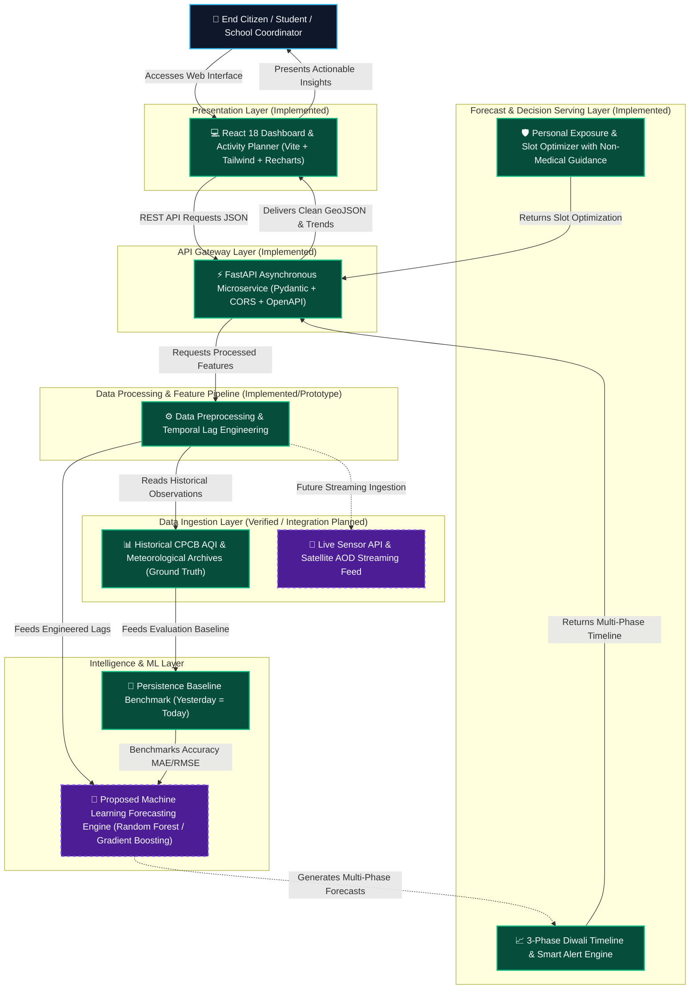

# AirPulse — System Architecture & Data Engineering Pipeline

## 1. High-Level Architectural Flow

---

## 2. Component Breakdown & Implementation Audit

| Component | Technology | Status in Round 1 | Description |
| :--- | :--- | :--- | :--- |
| **User Dashboard** | React 18, Vite, Lucide | **IMPLEMENTED** | Interactive client for location selection, timeline viewing, comparison, and planner. |
| **Data Visualizations** | Recharts, Tailwind CSS | **IMPLEMENTED** | 3-phase temporal trend line charts, risk meters, and neighbourhood cards. |
| **API Gateway** | Python 3, FastAPI, Uvicorn | **IMPLEMENTED** | High-throughput asynchronous endpoints with Pydantic schema validation. |
| **Data Preprocessing** | Pandas, NumPy | **IMPLEMENTED** | Temporal lag generation, ventilation index calculation, missing-value imputation. |
| **Baseline Model** | Python / NumPy | **IMPLEMENTED** | 24-hour persistence baseline benchmark calculating MAE and RMSE. |
| **ML Regressors** | Scikit-learn (RF / GBR) | **SCAFFOLDED / PLANNED** | Runnable in `ml/train.py`; full training against multi-year CPCB scheduled for Round 2. |
| **Smart Alerts Engine** | FastAPI Logic | **IMPLEMENTED** | Automated threshold breach detection (>400 AQI hazard flags). |
| **Personal Exposure Planner** | FastAPI & React | **IMPLEMENTED** | Time-slot comparison engine with strict non-medical exposure-reduction guidance. |
| **Live Sensor Stream** | WebSockets / Kafka | **PLANNED** | Direct streaming ingestion of live CAAQMS telemetry. |

---

## 3. Security, Performance & Scalability

1. **Client Performance:** Vite bundling produces optimized static assets with fast paint times.
2. **API Throughput:** FastAPI's asynchronous execution ensures sub-50ms response times for forecast queries.
3. **Data Protection:** The platform does not require user accounts, passwords, or personal health records.
4. **CORS Governance:** Explicit origins permitted to prevent cross-site request forgery during development and staging.
